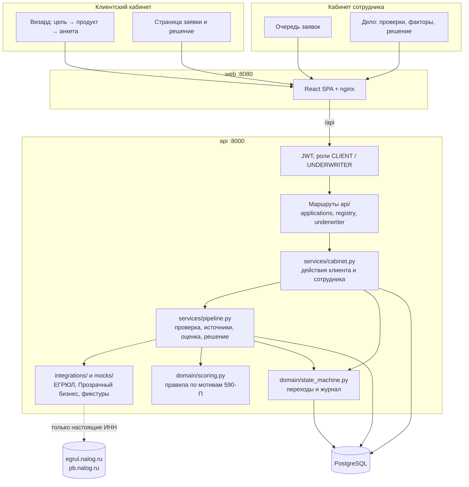
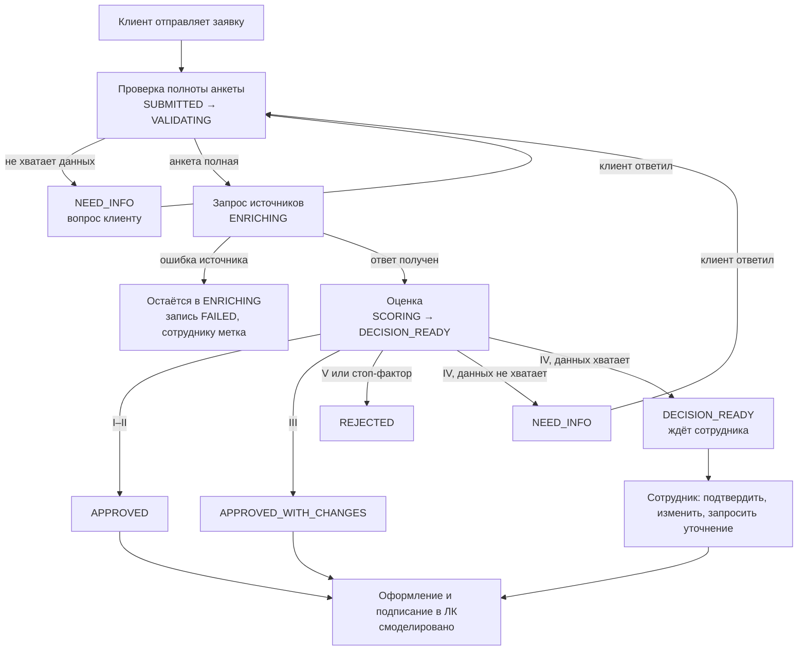
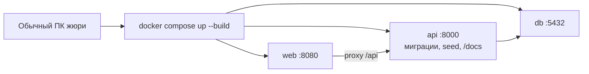

# Архитектурная схема

Модульный монолит: один backend (FastAPI), один frontend (React за nginx), PostgreSQL. Очереди сообщений и фонового воркера нет: после `submit` конвейер выполняется синхронно внутри запроса к API.

Внешние источники двух видов:

- **демо-ИНН** `7700000001`–`7700000005` и `7700000099` обслуживаются локальными фикстурами (`backend/app/mocks/fixtures.py`), сеть не нужна;
- **любой другой ИНН** запрашивается в открытых сервисах ФНС: поиск ЕГРЮЛ (egrul.nalog.ru) и «Прозрачный бизнес» (pb.nalog.ru). Для этого контейнеру `api` нужен выход в интернет. Кредитное бюро по ИНН не запрашивается.

LLM и платных API нет.

## Компоненты

Пунктирная стрелка: обращение к внешним сервисам идёт только для ИНН вне списка демо-ИНН.

## Кредитный конвейер

Конвейер запускается при отправке заявки и при ответе клиента на уточнение.

Статусы и допустимые переходы — в [state-machine.md](state-machine.md). Категория IV с достаточными данными автоматически не решается: расчёт (встречное предложение или отказ) сохраняется, заявка остаётся в `DECISION_READY` с пометкой «Ждёт сотрудника», а статус меняет сотрудник.

## Развёртывание

| Сервис | Образ / сборка | Порт | Назначение |
|---|---|---|---|
| `db` | `postgres:16-alpine` | 5432 | Данные приложения, том `pgdata` |
| `api` | `./backend` (`python:3.12-slim`) | 8000 | Бизнес-логика, OpenAPI, `/health` |
| `web` | `./frontend` (`node:22-alpine` для сборки, `nginx:1.27-alpine` для раздачи) | 8080 | Оба кабинета |

При старте API ждёт базу до 30 секунд, применяет миграцию Alembic и выполняет идемпотентный seed демо-пользователей. `web` стартует после того, как `api` здоров. Переменные API: `DATABASE_URL`, `JWT_SECRET` (значения для показа заданы в `docker-compose.yml`).

## Границы модулей в коде

| Модуль | Путь | Ответственность |
|---|---|---|
| State machine | `backend/app/domain/state_machine.py` | Единственное место, где меняется статус заявки |
| Продукты | `backend/app/domain/products.yaml`, `products.py` | Коридоры сумм и сроков, ставки, подбор |
| Scoring / decision | `backend/app/domain/scoring.py` | Балл, категория, условия; без HTTP и БД |
| Pipeline | `backend/app/services/pipeline.py` | Проверка полноты, источники, оценка, решение |
| Действия кабинетов | `backend/app/services/cabinet.py` | Черновик, отправка, ответы, оформление, решения сотрудника |
| Представления | `backend/app/services/serialize.py` | Данные для клиента и для сотрудника |
| Интеграции | `backend/app/integrations/` | Поиск ЕГРЮЛ, «Прозрачный бизнес», выбор между фикстурой и открытым сервисом |
| Фикстуры | `backend/app/mocks/` | Локальные ответы для демо-ИНН |
| API | `backend/app/api/` | Маршруты клиента, реестра и сотрудника; авторизация в `app/api/__init__.py` и `security.py` |
| UI | `frontend/src/pages/` | Визард, заявка, очередь, дело |

Связанные артефакты: [state-machine.md](state-machine.md), [data-model.md](data-model.md), [openapi.json](openapi.json), [api.http](api.http).

## Известные ограничения архитектуры

- Конвейер синхронный: запрос `submit` держится, пока идёт обращение к внешним сервисам. Для демо-ИНН это мгновенно, для настоящих зависит от ФНС.
- Ошибка источника не переводит заявку в отдельный статус и не повторяется: она остаётся в `ENRICHING` (дефект P1).
- Права сотрудника на смену решения не привязаны к стадии конвейера (дефект P0). Оба описаны в [REQUIREMENTS_CHECKLIST.md](REQUIREMENTS_CHECKLIST.md).
- CORS открыт для всех источников, секреты демонстрационные: конфигурация рассчитана на локальный показ.
