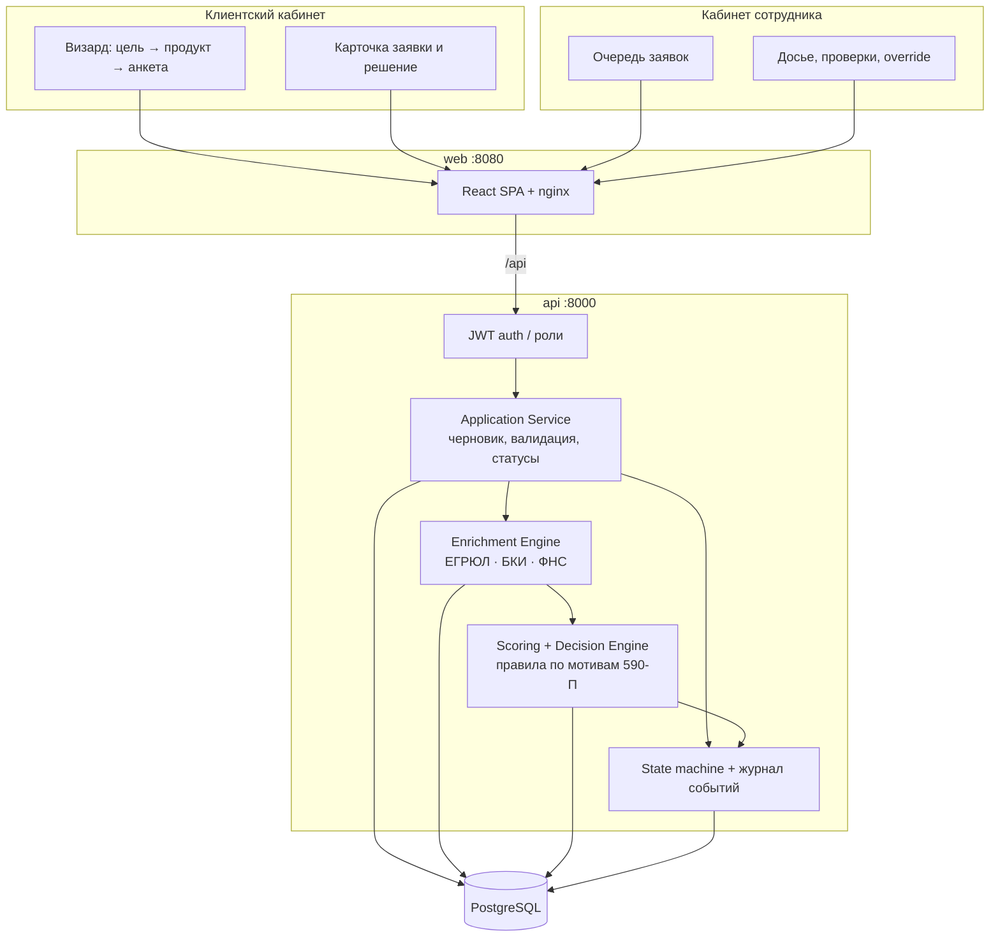
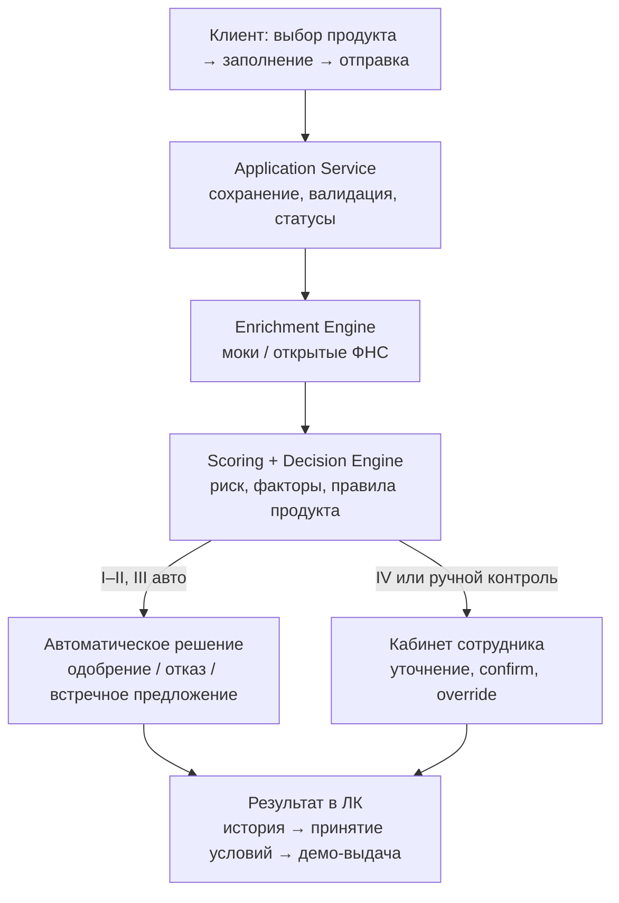
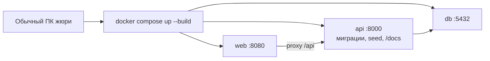

# Архитектурная схема

Модульный монолит: один backend (FastAPI), один frontend (React), PostgreSQL. Внешние источники — локальные моки плюс опциональные открытые запросы к ФНС для не-демо ИНН. Очередь сообщений в MVP нет: конвейер после `submit` выполняется синхронно в API.

## Компоненты

## Внутренний кредитный конвейер

## Развёртывание

| Сервис | Образ / сборка | Порт | Назначение |
|---|---|---|---|
| `db` | `postgres:16-alpine` | 5432 | Заявки, события, проверки, скоринг |
| `api` | `./backend` | 8000 | Бизнес-логика, OpenAPI |
| `web` | `./frontend` → nginx | 8080 | Оба кабинета |

Переменные API: `DATABASE_URL`, `JWT_SECRET` (см. `docker-compose.yml`).

## Границы модулей в коде

| Модуль | Путь | Ответственность |
|---|---|---|
| State machine | `backend/app/domain/state_machine.py` | Единственное место смены статуса |
| Products | `backend/app/domain/products.yaml` | Коридоры сумм, сроков, ставки |
| Scoring / decision | `backend/app/domain/scoring.py` | Балл, категория, оффер; без HTTP и БД |
| Pipeline | `backend/app/services/pipeline.py` | validate → enrich → score → decide |
| Mocks / registry | `backend/app/mocks`, `integrations/` | ЕГРЮЛ, БКИ, «Прозрачный бизнес» |
| Cabinets API | `backend/app/api/` | Клиент и underwriter |
| UI | `frontend/src/pages/` | Визард, заявка, очередь, дело |

Связанные артефакты: [state-machine.md](state-machine.md), [data-model.md](data-model.md), [openapi.json](openapi.json), [api.http](api.http).
