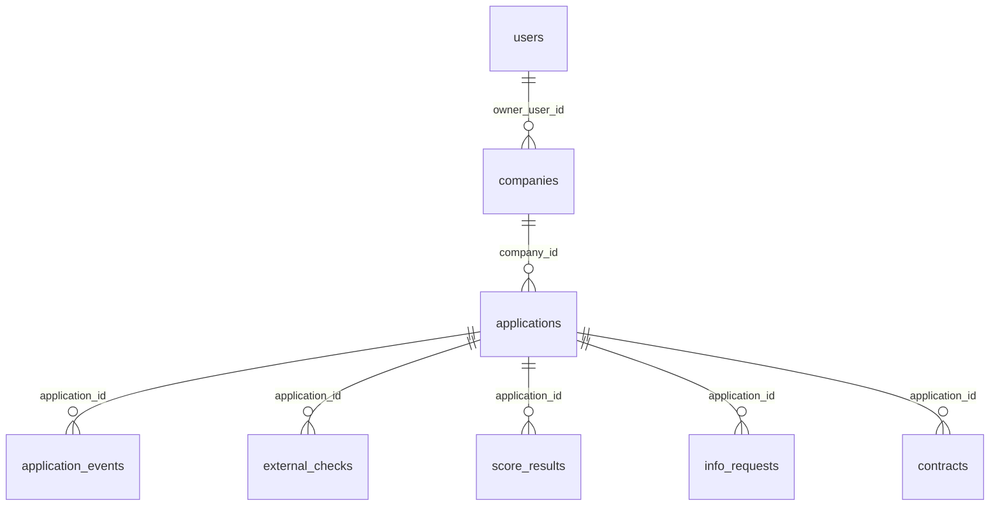

# Модель данных

PostgreSQL 16. Схема создаётся единственной миграцией Alembic `0001_initial` (`backend/alembic/versions/0001_initial.py`), модели описаны в `backend/app/models.py`. Первичные ключи — UUID. Деньги хранятся как `Numeric`, время как `timestamptz`.

У пользователя много компаний, у компании много заявок. На практике при создании черновика для каждой заявки создаётся новая запись `companies` (`create_draft`), поэтому одна компания обычно связана с одной заявкой. У заявки много событий, проверок, расчётов, вопросов и договоров. «Актуальные» проверка и расчёт — последние по времени создания: старые записи не удаляются.

## Таблицы

### `users`

| Поле | Тип | Примечание |
|---|---|---|
| `id` | uuid | ключ |
| `email` | varchar(255) | уникальный индекс, хранится в нижнем регистре |
| `password_hash` | varchar(255) | pbkdf2-sha256 |
| `full_name` | varchar(255) | |
| `phone` | varchar(32) | пустая строка, если не указан |
| `role` | varchar(32) | `CLIENT` или `UNDERWRITER` |
| `created_at` | timestamptz | |

### `companies`

Все поля, кроме `owner_user_id`, допускают `NULL`.

| Поле | Тип | Примечание |
|---|---|---|
| `id` | uuid | ключ |
| `owner_user_id` | uuid | внешний ключ на `users.id`; по нему проверяется доступ клиента к заявке |
| `inn` | varchar(12) | вводит клиент |
| `ogrn` | varchar(15) | заполняется конвейером из ответа реестра |
| `name` | varchar(500) | при создании черновика — ФИО пользователя, затем краткое название из реестра |
| `legal_form` | varchar(8) | `OOO` или `IP` |
| `okved` | varchar(16) | из реестра |
| `registration_date` | date | из реестра |
| `director_name` | varchar(255) | из реестра |
| `address` | varchar(500) | из реестра |
| `registry_status` | varchar(32) | статус компании в реестре |

Реестровые поля записываются на шаге `ENRICHING` из ответа слоя интеграций: для демо-ИНН это локальная фикстура, для настоящего ИНН — открытый поиск ЕГРЮЛ (egrul.nalog.ru). Подробности — в [architecture.md](architecture.md).

### `applications`

| Поле | Тип | Примечание |
|---|---|---|
| `id` | uuid | ключ |
| `public_number` | varchar(16) | уникальный индекс, вид `AK-10001` |
| `company_id` | uuid | внешний ключ на `companies.id` |
| `product_code` | varchar(32) | `TURNOVER`, `DEVELOPMENT`, `OVERDRAFT`, `LINE` |
| `purpose` | varchar(32) | `TURNOVER`, `DEVELOPMENT`, `CASH_GAP`, `UNKNOWN` |
| `amount` | numeric(14,2) | запрошенная сумма |
| `term_months` | integer | запрошенный срок |
| `monthly_revenue` | numeric(14,2) | выручка в месяц, может быть `NULL` |
| `monthly_expenses` | numeric(14,2) | расходы в месяц; сохраняются, но конвейер их не проверяет и скоринг их не использует |
| `comment` | text | комментарий клиента |
| `status` | varchar(32) | индекс; допустимые значения — в [state-machine.md](state-machine.md) |
| `created_at`, `updated_at` | timestamptz | |

Номер формируется как `AK-` и 10001 плюс число существующих заявок. Это вычисление по количеству, а не последовательность БД: при одновременном создании двух черновиков возможен конфликт уникального индекса (см. «Известные дефекты» в [REQUIREMENTS_CHECKLIST.md](REQUIREMENTS_CHECKLIST.md)).

### `application_events`

Журнал. Строка создаётся при каждом переходе статуса и при записи события без перехода.

| Поле | Тип | Примечание |
|---|---|---|
| `application_id` | uuid | |
| `from_status` | varchar(32) | `NULL` допустим |
| `to_status` | varchar(32) | при записи без перехода совпадает с текущим статусом |
| `actor_type` | varchar(32) | `CLIENT`, `SYSTEM`, `UNDERWRITER` |
| `actor_user_id` | uuid | `NULL` для системы |
| `message` | text | текст на простом языке |
| `payload_json` | jsonb | например `score_id`, `category` |
| `created_at` | timestamptz | метки внутри одного запроса строго возрастают (`app/clock.py`) |

### `external_checks`

Ответы источников.

| Поле | Тип | Примечание |
|---|---|---|
| `source` | varchar(16) | `EGRUL`, `BKI`, `FNS`, при сбое только `EGRUL` |
| `status` | varchar(16) | `SUCCESS` или `FAILED` |
| `request_json` | jsonb | `{"inn": ...}` |
| `response_json` | jsonb | сырой ответ источника или `{"error": ...}` |
| `created_at` | timestamptz | |

Повторный прогон конвейера добавляет новые строки, а не заменяет прежние. Для настоящего ИНН ответ `BKI` содержит признак `available: false`: бюро по ИНН не запрашивается.

### `score_results`

Расчёт.

| Поле | Тип | Примечание |
|---|---|---|
| `score` | integer | 100 минус сумма вычетов |
| `financial_position` | varchar(16) | положение |
| `debt_service` | varchar(16) | обслуживание долга |
| `quality_category` | varchar(4) | I–V |
| `stop_factors_json` | jsonb | список стоп-факторов |
| `factors_json` | jsonb | факторы (`code`, `title`, `detail`); клиенту не отдаются |
| `decision` | varchar(32) | `APPROVED`, `APPROVED_WITH_CHANGES`, `REJECTED`, `NEED_INFO` |
| `offered_amount`, `offered_term_months`, `offered_rate`, `monthly_payment` | numeric / integer | условия решения, могут быть `NULL` |
| `explanation` | text | пояснение для сотрудника |
| `client_explanation` | text | короткое пояснение клиенту |
| `awaits_employee` | boolean | категорию IV должен подтвердить человек |
| `created_at` | timestamptz | |

Решение сотрудника (`override`) тоже сохраняется строкой в эту таблицу: с одним фактором `manual`, комментарием сотрудника в обоих пояснениях и `awaits_employee = false`. Остальные поля копируются из предыдущего расчёта. Если расчёта не было, подставляются категория IV, балл 0 и средние значения: это следствие дефекта разрешённого ручного решения до окончания конвейера.

### `info_requests`

| Поле | Тип | Примечание |
|---|---|---|
| `question` | text | вопрос банка |
| `answer` | text | ответ клиента, `NULL` пока не ответил |
| `asked_by` | uuid | сотрудник; `NULL`, если вопрос задала система |
| `created_at`, `answered_at` | timestamptz | |

### `contracts`

| Поле | Тип | Примечание |
|---|---|---|
| `terms_json` | jsonb | условия на экране оформления, флаг `simulated: true` |
| `status` | varchar(16) | `DRAFT` или `SIGNED` |
| `signed_at` | timestamptz | `NULL` до подписания |

Запись создаётся, когда клиент открывает оформление, и помечается `SIGNED` при нажатии «Подписать». Электронной подписи и выдачи денег нет: меняется только статус.

## Что в схеме не задано

- Нет ограничений `CHECK` на значения статусов, ролей, решений и категорий: допустимые значения контролирует код.
- Нет каскадного удаления и операций удаления: записи не удаляются.
- Нет отдельной таблицы продуктов: коридоры и ставки лежат в `backend/app/domain/products.yaml`.
- Нет таблицы сессий: токен JWT (HS256, срок 12 часов, роль внутри токена) не хранится в БД.
