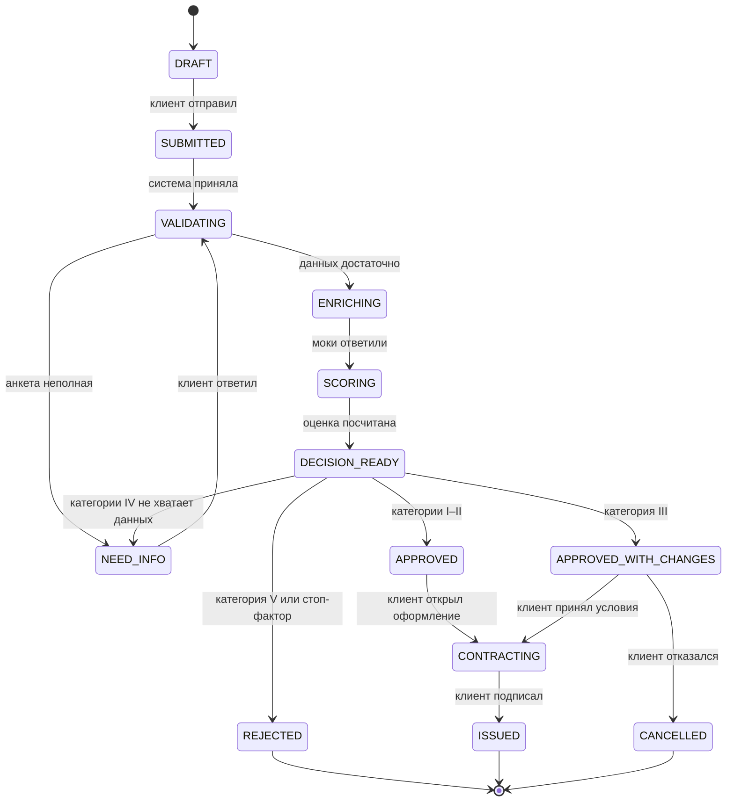

# Состояния заявки

Менять статус может только модуль `backend/app/domain/state_machine.py`. Каждый переход пишет строку в `application_events`.

Категория IV с уже собранными данными остаётся в `DECISION_READY`, пока сотрудник не подтвердит или не изменит решение.

Сотрудник из любого незавершённого статуса может перевести заявку в `NEED_INFO`, `APPROVED`, `APPROVED_WITH_CHANGES` или `REJECTED`. Комментарий обязателен, если решение меняется вручную.

`REJECTED`, `ISSUED` и `CANCELLED` — конечные статусы. Переход вроде `ISSUED → DRAFT` отклоняется.
