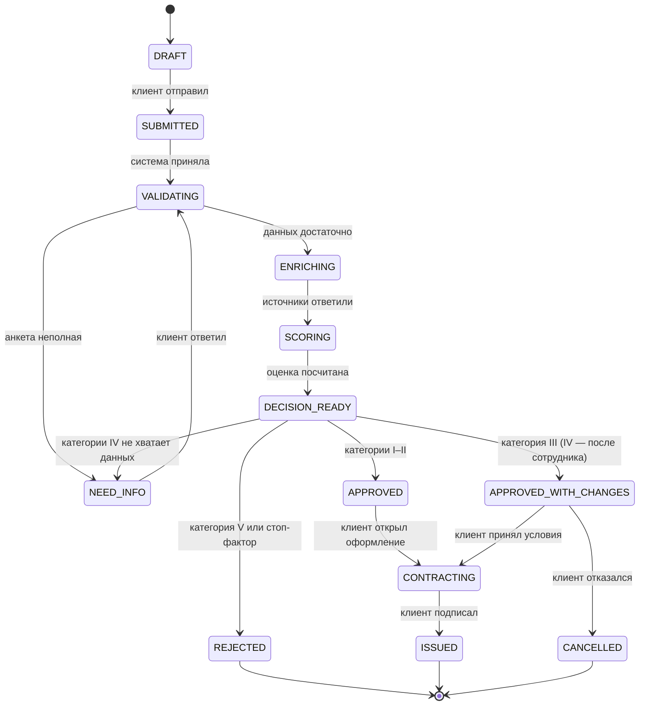

# Состояния заявки

Статус меняет только функция `transition()` в `backend/app/domain/state_machine.py`. Каждый переход пишет строку в `application_events` с типом актора (`CLIENT`, `SYSTEM`, `UNDERWRITER`), сообщением и, если есть, ссылкой на расчёт в `payload_json`. Запись события без смены статуса (`log_event`) тоже попадает в журнал: так видны уточнения без перехода и подтверждения сотрудника.

## Диаграмма

Диаграмма показывает переходы клиента и системы. Переходы сотрудника вынесены в отдельный раздел ниже, потому что у них другое правило.

## Таблица переходов

| Из | В | Кто | Условие |
|---|---|---|---|
| `DRAFT` | `SUBMITTED` | клиент | `POST /api/applications/{id}/submit` |
| `SUBMITTED` | `VALIDATING` | система | сразу после отправки |
| `VALIDATING` | `NEED_INFO` | система | анкета не прошла проверку полноты (ИНН, форма, минимальная сумма и срок продукта, выручка) |
| `VALIDATING` | `ENRICHING` | система | анкета заполнена |
| `NEED_INFO` | `VALIDATING` | клиент | `POST .../answers`, пока есть вопрос без ответа |
| `ENRICHING` | `SCORING` | система | источники ответили |
| `SCORING` | `DECISION_READY` | система | расчёт сохранён |
| `DECISION_READY` | `APPROVED` | система | категории I–II |
| `DECISION_READY` | `APPROVED_WITH_CHANGES` | система | категория III |
| `DECISION_READY` | `NEED_INFO` | система | категория IV, не хватает данных |
| `DECISION_READY` | `REJECTED` | система | категория V или стоп-фактор |
| `APPROVED` | `CONTRACTING` | клиент | `POST .../accept-offer` |
| `APPROVED_WITH_CHANGES` | `CONTRACTING` | клиент | `POST .../accept-offer` |
| `APPROVED_WITH_CHANGES` | `CANCELLED` | клиент | `POST .../decline-offer` |
| `CONTRACTING` | `ISSUED` | клиент | `POST .../sign` (подписание и выдача смоделированы) |

Девять переходов системы и шесть переходов клиента заданы в коде как `SYSTEM_EDGES` и `CLIENT_EDGES`. Любая другая пара отклоняется с ошибкой `TransitionError`, API отвечает 409.

## Категория IV

Категория IV с собранными данными остаётся в `DECISION_READY`: в расчёте стоит `awaits_employee`, а в журнал пишется «Категория IV: решение ждёт сотрудника банка». В расчёте уже лежит предложение с другими условиями или отказ, но клиенту оно не показывается. Статус меняется только действием сотрудника: «подтвердить» переводит заявку в решение расчёта (`APPROVED_WITH_CHANGES` или `REJECTED`), «изменить решение» задаёт своё. Если у компании возраст меньше 6 месяцев или не указана выручка, а клиент ещё не отвечал на уточнение, система задаёт вопрос и переводит заявку в `NEED_INFO`. После ответа клиента конвейер идёт заново и добавляет новый расчёт: старые расчёты не удаляются.

## Действия сотрудника

Правило сотрудника задано иначе, чем у клиента и системы: это не таблица пар, а набор допустимых целей `UNDERWRITER_TARGETS = {NEED_INFO, APPROVED, APPROVED_WITH_CHANGES, REJECTED}`.

| Действие | Эндпоинт | Что делает |
|---|---|---|
| Подтвердить | `POST /api/underwriter/applications/{id}/confirm` | В статусе `DECISION_READY` переводит заявку в решение последнего расчёта и снимает `awaits_employee`. В остальных статусах только пишет в журнал |
| Изменить решение | `POST .../override` | Добавляет новый расчёт с решением сотрудника и переводит заявку в выбранный статус. Комментарий обязателен (от 3 символов). Для `APPROVED_WITH_CHANGES` нужны сумма, срок и ставка |
| Запросить уточнение | `POST .../request-info` | Добавляет вопрос и переводит заявку в `NEED_INFO` (если она уже там, только пишет в журнал) |

Проверка в коде (`ensure_transition`): для сотрудника отклоняются только конечные статусы (`REJECTED`, `ISSUED`, `CANCELLED`), цель вне `UNDERWRITER_TARGETS` и «переход» в тот же статус.

**Известный дефект (на этапе 1 не исправляется).** Других ограничений нет, поэтому сотрудник технически может вынести решение по заявке в `DRAFT`, `SUBMITTED`, `VALIDATING`, `ENRICHING`, `SCORING`, `CONTRACTING`, то есть до завершения конвейера. Ручное решение по заявке без расчёта создаёт запись расчёта с подставленными значениями (категория IV, балл 0). Описание — в разделе «Известные дефекты» [REQUIREMENTS_CHECKLIST.md](REQUIREMENTS_CHECKLIST.md). Диаграмма выше не показывает это поведение, чтобы не выдавать его за задуманное.

## Сбой источника данных

Если запрос к источнику (ЕГРЮЛ, фикстура или открытый сервис ФНС) завершается ошибкой, система сохраняет проверку `EGRUL` со статусом `FAILED`, пишет сообщение в журнал и останавливает конвейер. Заявка остаётся в `ENRICHING`: перехода из `ENRICHING` в другой статус по ошибке нет, автоповтора нет, у клиента нет действия для повтора. Для сотрудника заявка в очереди помечена «Ждёт сотрудника». Это известный дефект (приоритет P1). Для демо-ИНН `7700000099` сбой воспроизводится только через API: в интерфейсе клиента кнопка отправки остаётся неактивной, потому что карточка организации по этому ИНН не находится.

## Конечные статусы

`REJECTED`, `ISSUED` и `CANCELLED` — конечные. Переход клиента или системы из них отклоняется, сотрудник тоже не может изменить такую заявку. Например, `ISSUED → DRAFT` невозможен.

## Клиентские подписи

Тексты статусов для клиента заданы в ТЗ (раздел 5) и показываются в интерфейсе, например: `NEED_INFO` — «Нужны уточнения», `DECISION_READY` — «Готовим решение», `APPROVED_WITH_CHANGES` — «Есть предложение с другими условиями», `ISSUED` — «Финансирование оформлено».
